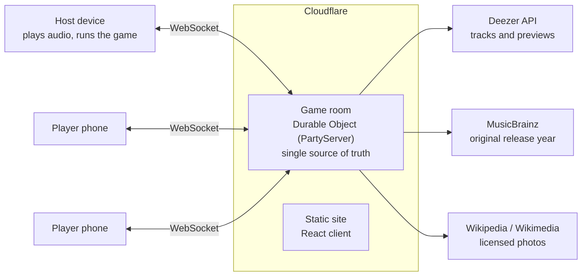

# Geekasong

A realtime party quiz for music nights. One device plays the music, everyone else buzzes from their phone. No app to install, no account, join with a room code or a QR code.

**Play it:** [geekasong.com](https://geekasong.com)

Built and run by me as a product builder: I scoped it, designed the game rules, wrote it with AI coding tools (Cursor, Claude) and run it in production on Cloudflare.

**Product thinking:** the decisions behind it are in [PRODUCT.md](PRODUCT.md).

## Game modes

| Mode | How it plays |
|---|---|
| Blind test | A 30 second preview plays. First buzz pauses the music and that player shouts the answer. Wrong answer locks them out for that song. |
| Find the year | Everyone locks in a year. 3 points for exact, 2 within two years, 1 within five. |
| Song with a word | A word appears. The buzzer sings a song containing it, the other players vote. |
| Mashup | Two songs play at once. Points for each one found. |
| Famous faces | Two celebrity photos morphed into one face, hints appear over time. |
| Mixed game | Rotates through every mode. |

51 music categories across 7 groups (decades, rock and metal, urban, world, screen and more), in English, French or both. Two play styles: phone buzzers, or one device where the host gives the points.

## Architecture



* **One room = one Durable Object.** All game state lives on the server: phase, scores, timers, who buzzed, votes. Clients send intents (`buzz`, `guess`, `vote`, `next`) and receive a full state snapshot after every change. Message types are shared between client and server in `src/types.ts`.
* **Explicit state machine.** `lobby → loading → playing → buzzed → reveal → finished`. Every message is checked against the current phase and role, so a late buzz or a player trying a host action is simply ignored.
* **Server decides who buzzed first.** The first `buzz` message to reach the room wins. The server pauses the round clock, stores the time left, and resumes from that point if the answer is wrong.

## Problems worth solving

* **Phones lock mid game.** When a phone drops, its score is parked and restored when the same device reconnects. If the player who buzzed disconnects, the round resumes for everyone. If a voter drops, the vote stops waiting for them.
* **Nobody can cheat by inspecting the page.** Only the host connection receives the audio preview URLs. Players get the title and artist at the reveal, never before.
* **Deezer gets release years wrong.** Remasters and compilations show up as 2011 for a 1975 song. The server asks MusicBrainz for every recording of that title by that artist and keeps the earliest year, with Deezer's date as the fallback. MusicBrainz allows about one request per second, so calls go through a polite queue with timeouts.
* **Famous faces is a real face morph, not a cross fade.** In the browser: detect 68 facial landmarks on each photo, average the two shapes, triangulate (Delaunay), warp each photo onto the average shape triangle by triangle and blend them. The 1.9 MB model only loads when a faces round starts, and there is a cross fade fallback if no face is found.
* **Photo licensing.** Celebrity photos come only from Wikimedia Commons (free licences). Fair use images that live only on Wikipedia are skipped, and the author and licence are credited at the reveal.
* **Stale background work.** Each new game bumps a game id, so song loading or year lookups from a previous game can never write into the current one.

## Stack

TypeScript, React 19, PartyServer / PartySocket on Cloudflare Workers and Durable Objects, esbuild, Wrangler, Deezer API, MusicBrainz API, Wikipedia REST API, face-api.js and Delaunator for the morph, QR codes for joining.

## Run locally

```bash
npm install
npm run dev
```

Open the address Wrangler prints (for example `http://192.168.x.x:1999`) on the host and on phones on the same wifi.

## Deploy

```bash
npx wrangler login   # first time only
npm run deploy
```

## Code map

| File | What it does |
|---|---|
| `src/server.ts` | Game room: state machine, buzz arbitration, scoring, votes, reconnects |
| `src/types.ts` | Shared message contract and game settings |
| `src/deezer.ts` | Category playlists and track loading |
| `src/years.ts` | Original release year lookup via MusicBrainz |
| `src/faces.ts` | Famous people, licensed photos and credits |
| `src/morph.ts` | In browser face morph |
| `src/client.tsx`, `src/lobby.tsx` | Host and player screens |

## Roadmap

* Difficulty levels per game (easy, medium, hard)
* Pixelated famous faces that sharpen over time
* Non music rounds: reversed phrases, a host led quiz show
